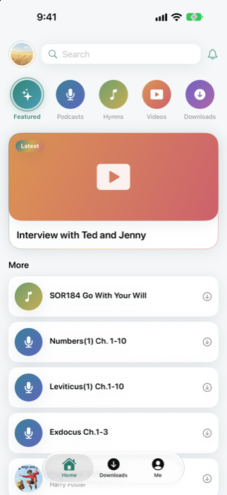
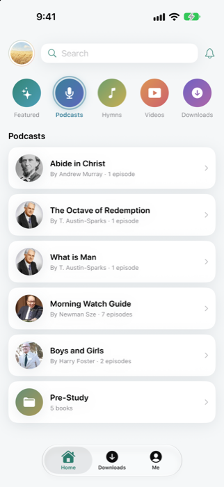
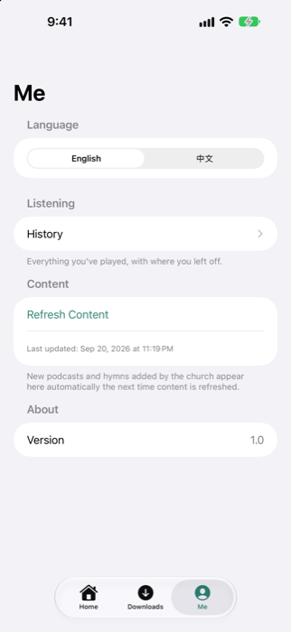

# 拾穗 | Gleaning: church app for SJCA

An iPhone app for my church, San Jose Christian Assembly. People use it to listen to sermons and hymns, and watch videos, in English or Chinese. I built it myself, start to finish, and it's [live on the App Store](https://apps.apple.com/us/app/%E6%8B%BE%E7%A9%97-sjca/id6814304145).

The source code is private. This page is a tour of what it does and how it's put together.

  
  
  

## Why I made it

The church wanted an easy way to get sermons and music in front of the congregation without a third-party podcast app. A lot of the congregation reads Chinese more comfortably than English, so the whole app works in both languages and switches anytime.

## What it does

- Sermons, hymns, and videos in browsable folders, with English and Chinese content kept separate
- Video hymns and videos play with full-screen landscape
- Offline downloads for anything
- Audio keeps playing with the screen off, with Lock Screen controls, and remembers where you left off
- New content shows up on its own, with no App Store update needed
- An update screen that asks people to upgrade when a newer version is out

## How it's built

- Swift and SwiftUI, AVFoundation for playback, XcodeGen for the project file
- Content is a single manifest file hosted on Firebase Storage. The app ships with a bundled copy, so it works with no internet, then refreshes hourly and on launch
- I wrote a small Python and Flask uploader that lets church staff add episodes without touching code
- Unit tests for language handling, folder visibility, media type detection, and the bundled manifest, run in CI

## A few things I learned

- The app stores Chinese as `zh-Hans`, and an early check for plain `zh` quietly never matched. That bug is why the language tests exist
- The App Store lookup that powers the update screen is CDN-cached for about a day, so the gate needs cache-busting to be timely
- A video hymn is just a hymn whose file is an `.mp4`. The app decides from the file extension, so adding one needs no manifest change

## Status

[Live on the App Store](https://apps.apple.com/us/app/%E6%8B%BE%E7%A9%97-sjca/id6814304145). Built and maintained solo.

Questions or want to talk about it? allenlong2007@gmail.com
